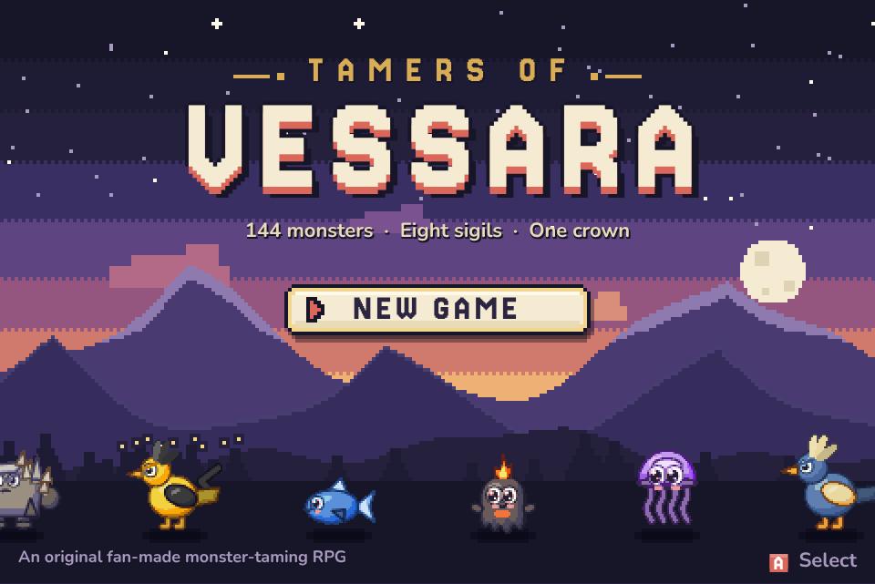
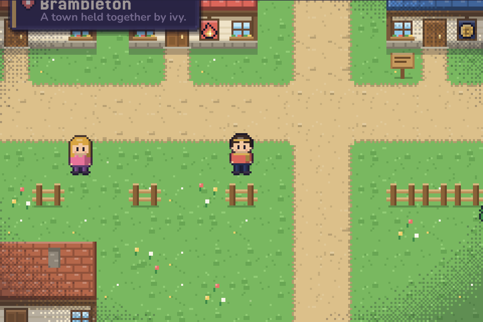
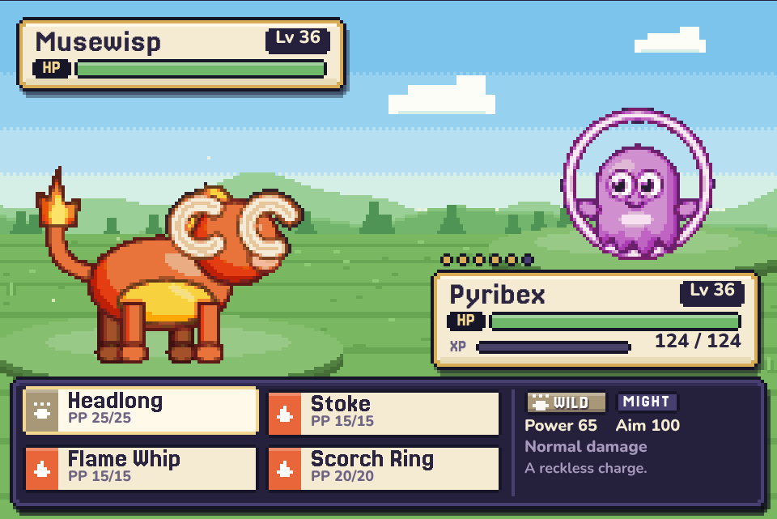
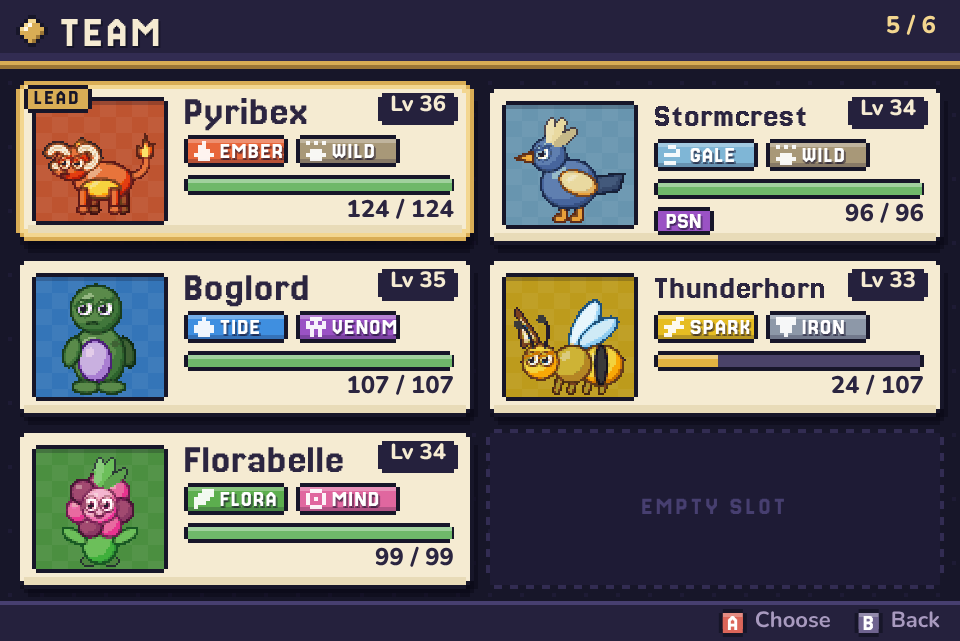
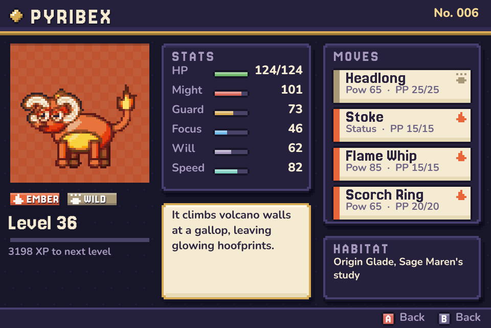
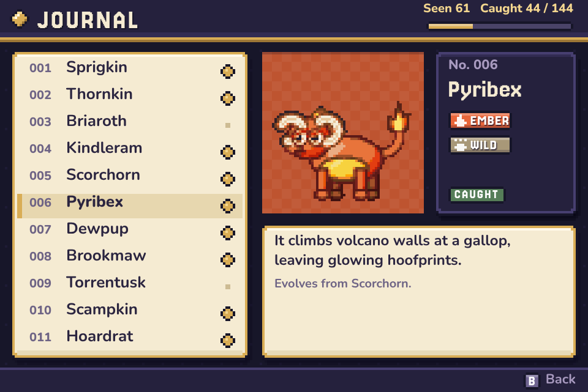
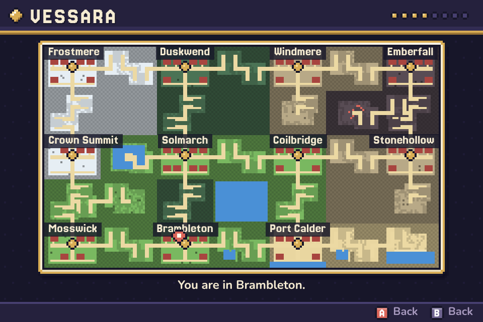

# Tamers of Vessara

A monster-taming RPG that runs in the browser. 144 original monsters, an original region with eleven towns, eight wardens to beat and a crown to win. No build step, no dependencies, no image files: every sprite and tile is drawn by code.



| | |
|---|---|
|  |  |
|  |  |
|  |  |

## Play

Open `index.html` in a browser. That is all it needs.

If your browser blocks local files, serve the folder instead:

```
python3 -m http.server 8000
```

and visit `http://localhost:8000`.

To put it online, turn on GitHub Pages for this repository (Settings, Pages, deploy from the `main` branch root).

### Controls

| Action | Keyboard | Touch |
|---|---|---|
| Move | Arrow keys or WASD | D-pad |
| Confirm, talk, fish | Z, Enter or Space | A |
| Back; hold to run | X, Esc or Shift | B |
| Menu | M or Tab | MENU |

The game saves to the browser's local storage. Use Save in the menu, or rest at any Hearth House.

## What is in it

- **144 monsters** in 69 evolution families, across 12 types. In Journal order they fall into nine groups of 16, one per 4x4 sprite sheet, and no evolution family is split across two sheets. Each has its own stats, learnset, catch rate, Journal entry and habitat.
- **Three starters**: Sprigkin (Flora), Kindleram (Ember) and Dewpup (Tide). Your rival takes the one that beats yours.
- **Turn-based battles** with physical, focus and status moves, 126 moves in all, five conditions (burn, frostbite, poison, sleep, stun), stat stages, critical hits, priority, multi-hit, drain and recoil.
- **Charms** for catching wild monsters, a six-monster team, and a Paddock for the rest.
- **One seamless overworld** of 196 by 110 tiles: 11 towns, 14 routes and 6 wild areas, with tall grass, fishing, 39 route tamers, hidden items and road wardens who check your sigils.
- **Eight wardens**, then four councillors and the High Warden at Crown Summit.
- **Six legendary monsters**, one waiting in each wild area. The last one only appears after you win the crown.
- Journal, team, bag, region map, shops whose stock grows with your sigils, and evolution scenes.

### Look and feel

- **One design system.** A night, parchment and gold palette, a pixel display face for names and headings, and a rounded sans for anything you read in a sentence. Panels, bars, chips, icons and key hints are shared by every screen (`js/ui.js`).
- **A living overworld.** Tile variants, soft path and shore edges, tall trees you can walk behind, shadows, swaying grass, moving water, pollen, fireflies, embers and snow by biome, and a day and night cycle with lit windows.
- **Battles with weight.** Painted backdrops per biome, a damage trail on HP bars, hit flashes, floating damage numbers, effectiveness callouts, and a move menu that shows type, power, aim and how well each move will land.
- **Dialogue with faces.** Name plates and portraits for whoever is speaking.
- **Crisp at any size.** The 480 by 320 screen snaps to whole-number scales where it can, and the team screen switches to a single column on small displays.

### The region

| Town | Warden | Type |
|---|---|---|
| Mosswick | (home, Sage Maren's study) | |
| Brambleton | Fern | Flora |
| Port Calder | Marlow | Tide |
| Coilbridge | Volta | Spark |
| Stonehollow | Garnet | Stone |
| Emberfall | Ignacia | Ember |
| Windmere | Aerin | Gale |
| Duskwend | Morwen | Shade |
| Frostmere | Halvard | Frost |
| Solmarch | (crossroads, no warden) | |
| Crown Summit | The Council and the High Warden | |

Routes: Dewpath, Tidewalk, Saltmarsh, Whisperwood, Thornwood, Coil Road, Kingsroad, Quarry Trail, Cinder Climb, Skyreach, Lantern Road, Gloam Hollow, Rimewalk, Starfall Pass.

Wild areas: Sunken Coast, Deepquarry, Caldera, Stormspire, Mirror Lake, Origin Glade.

### Types

Wild, Flora, Ember, Tide, Spark, Stone, Gale, Frost, Venom, Mind, Shade, Iron.

Tide beats Ember, Ember beats Flora, Flora beats Tide. The full chart is in `js/core.js`, and people in the towns will tell you most of it.

## Code layout

```
index.html           page shell, header and touch pad
css/style.css        page styling
js/core.js           constants, random helpers, type chart
js/data/moves.js     all moves and the per-type move ladders
js/data/monsters.js  the 144 monsters and their learnsets
js/data/items.js     items and shop stock
js/data/world.js     the region: cells, tamers, wardens, map generation, interiors
js/ui.js             design system: palette, type, panels, bars, chips, icons
js/sprites.js        procedural pixel art for monsters, people, tiles and scenery
js/scenery.js        battle backdrops, title landscape, weather, daylight
js/state.js          save data, monster instances, stats
js/engine.js         canvas, game loop, input, dialogue box, menu primitives
js/screens.js        pause menu, team, bag, journal, map, shop, paddock, evolution, title
js/overworld.js      walking, world rendering, NPC scripts, encounters, fishing
js/battle.js         the battle system and its presentation
js/main.js           boot
tools/check.js       data and map checks
```

To add a monster, add a row to `FAMILIES` in `js/data/monsters.js` and put it in an encounter list in `js/data/world.js`. Its sprite is assembled from the body, colour and feature codes in that row.

### Checks

```
node tools/check.js
```

This confirms there are exactly 144 uniquely named monsters, every learnset and tamer team refers to things that exist, every monster family can be obtained somewhere, every town, door, sign, item and tamer on the map can be reached on foot, and no road warden can be walked around.

## Originality

All names, creatures, art, places and text were made for this project. It is a fan-made tribute to the monster-taming genre and is not affiliated with or endorsed by Nintendo, Game Freak or The Pokémon Company.
